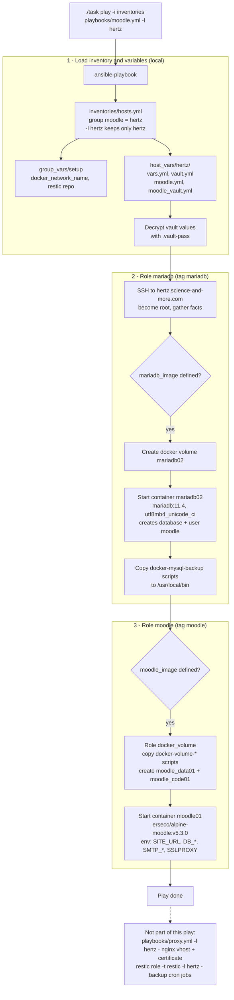
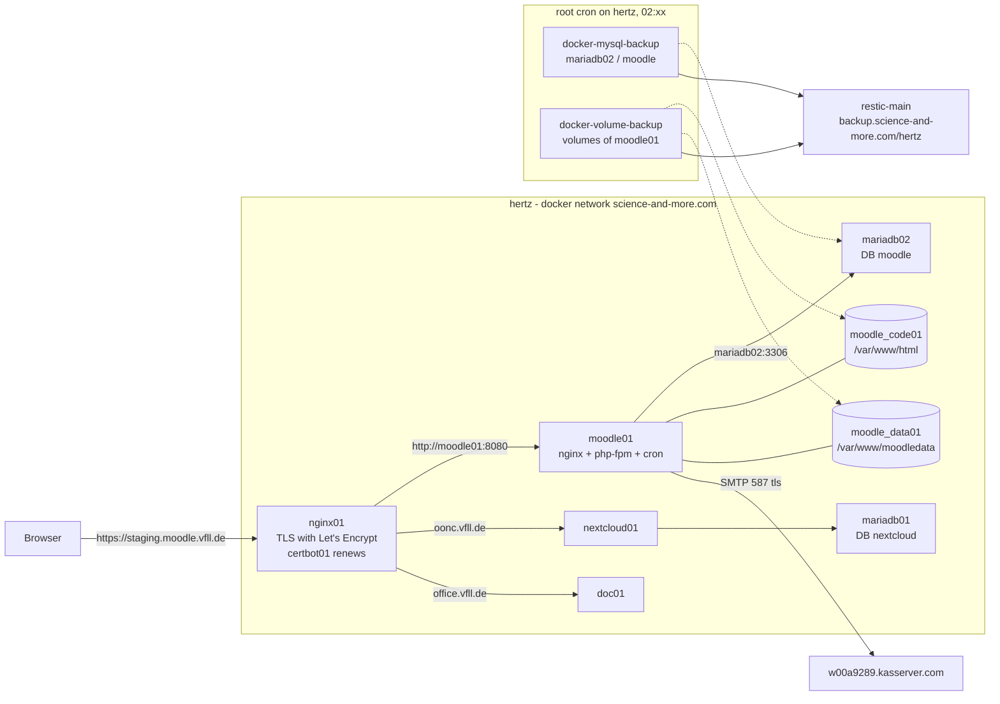
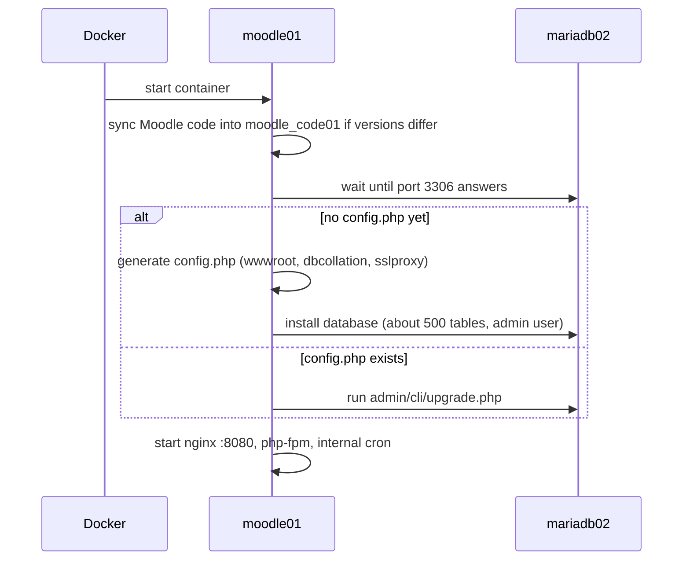

# Moodle role

Deploy Moodle Docker container.

## Usage

Configure the role.

```yml
# https://hub.docker.com/r/erseco/alpine-moodle (nginx + php-fpm on port 8080,
# cron runs inside the container). Pin a version tag, not latest.
moodle_image: erseco/alpine-moodle:v5.3.0
moodle_hostname: moodle01
moodle_volume_name: moodle_data01 # default: "{{ moodle_hostname }}"
moodle_code_volume_name: moodle_code01 # default: "{{ moodle_hostname }}_code"
# Behind a TLS-terminating reverse proxy (nginx_proxies -> moodle01:8080)
moodle_site_url: https://moodle.example.com # default: http://localhost
moodle_sslproxy: "true" # default: "false"
moodle_reverseproxy: "false" # only for multiple base URLs
moodle_username: admin
moodle_password: "{{ vault_moodle_password }}"
moodle_email: moodle@example.com
moodle_site_name: "School of Example"
moodle_language: de # default: en
moodle_database_type: mariadb # default: mariadb (also mysqli, pgsql)
moodle_database_host: mariadb02
moodle_database_port: "3306" # default: "3306", pgsql: "5432"
moodle_database_name: moodle
moodle_database_user: moodle
moodle_database_password: "{{ vault_moodle_database_password }}"
moodle_smtp_host: mail.example.com
moodle_smtp_port: "465" # default: "587"
moodle_smtp_user: bot@example.com
moodle_smtp_password: "{{ vault_moodle_smtp_password }}"
moodle_smtp_protocol: ssl # default: tls
moodle_mail_noreply_address: noreply@example.com # default: "{{ moodle_smtp_user }}"
moodle_php_max_upload_filesize: 128M # default 50M (php + nginx in the container)
moodle_volume_backup_set: # See restic_backup_set var in role restic
```

Put the config in `host_vars/<host>/moodle.yml` (secrets in `moodle_vault.yml`)
and add the host to the `moodle` group of the inventory:

```yml
moodle:
  hosts:
    hertz:
```

Then run [playbooks/moodle.yml](../../playbooks/moodle.yml), which deploys the
database role first:

```yml
- hosts: moodle
  roles:
    - role: mariadb
    - role: moodle
```

## How it works

Example: `./task play -i inventories playbooks/moodle.yml -l hertz`.

### Playbook run



### Runtime on the host



### Container start

Later starts skip the installer and run the database upgrade instead.



## Pitfalls

* `moodle_site_name`: the image passes it unquoted to the installer, so the role
  replaces spaces with `_`. Rename the site afterwards in the admin UI.
* MariaDB >= 11 defaults to `utf8mb4_uca1400_ai_ci`, which fails Moodle's
  unicode check. Set `mariadb_command: "--character-set-server=utf8mb4
  --collation-server=utf8mb4_unicode_ci"` before the first start; the installer
  writes the collation into `config.php`.
* Deploy Moodle before the proxy: `nginx -t` fails while `moodle01` is not
  running, and nginx keeps its old config until a reload succeeds.
